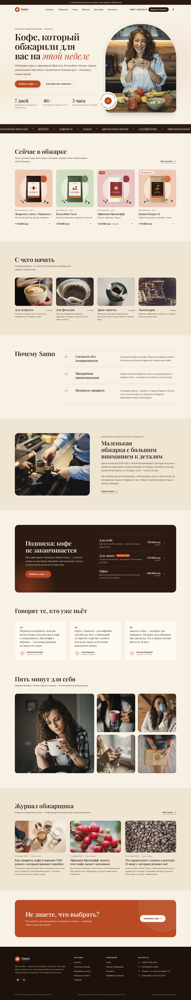
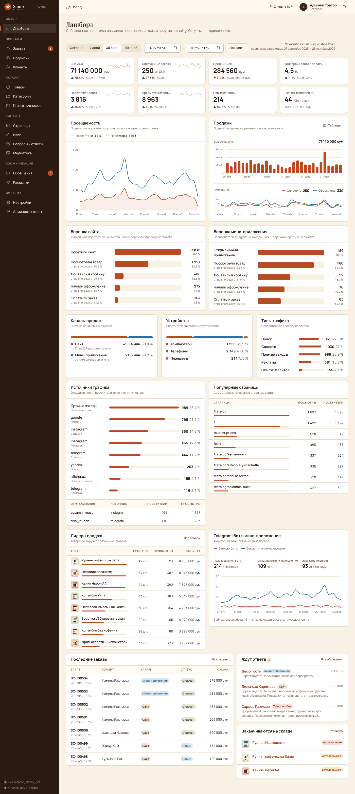
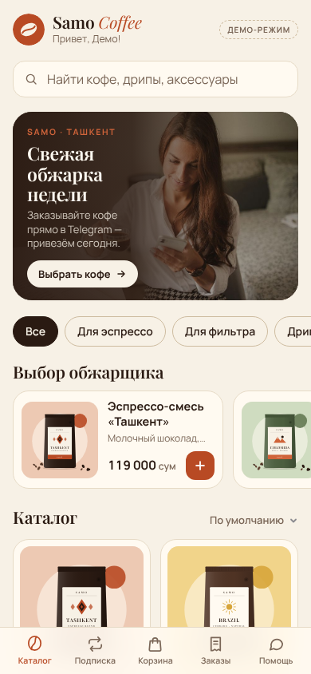
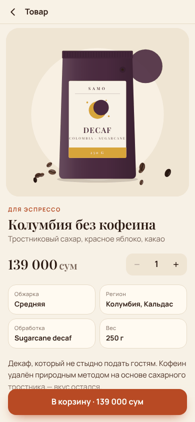
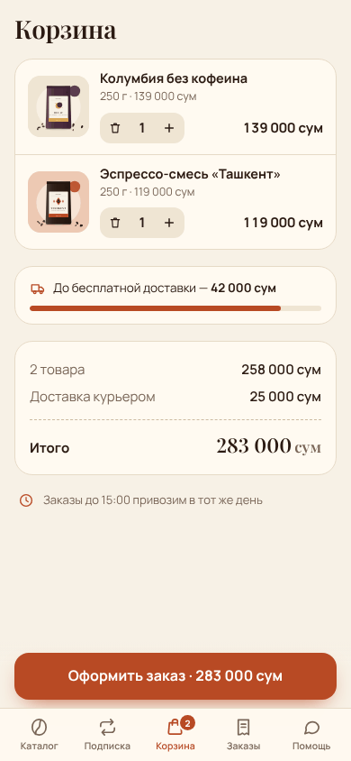

# Samo Coffee

Готовый интернет-магазин для обжарщика кофе (и любого небольшого бренда с каталогом и подпиской):
**сайт + админ-панель + Telegram-бот + Telegram Mini App + онлайн-оплата** в одном проекте.

- один процесс Node.js и один файл базы SQLite — запускается на самом дешёвом сервере или PaaS;
- без сборки, без TypeScript, без внешних сервисов и CDN: `npm ci && npm start`;
- все тексты и картинки сайта меняются из админ-панели, без программиста;
- оплата: демо-страница «из коробки», Telegram Payments, Payme, Click.

> **Samo Coffee — вымышленный демо-бренд.** Название, тексты, товары, отзывы и иллюстрации придуманы
> для демонстрации и заменяются на ваши (см. [«Как переделать под свой бренд»](#как-переделать-под-свой-бренд)).
> Фотографии на сайте — стоковые снимки со свободными лицензиями (CC0, CC BY) с Wikimedia Commons; авторы и
> лицензии перечислены на странице `/photo-credits` (ссылка в подвале) и в `public/img/photos/credits.json`.



## Содержание

- [Что входит в продукт](#что-входит-в-продукт)
- [Скриншоты](#скриншоты)
- [Быстрый старт](#быстрый-старт)
- [Демо-доступы](#демо-доступы)
- [Настройка: переменные окружения](#настройка-переменные-окружения)
- [Telegram-бот: создание и подключение](#telegram-бот-создание-и-подключение)
- [Mini App: подключение к боту](#mini-app-подключение-к-боту)
- [Онлайн-оплата](#онлайн-оплата)
- [Развёртывание](#развёртывание)
- [Устройство проекта](#устройство-проекта)
- [Как переделать под свой бренд](#как-переделать-под-свой-бренд)
- [Безопасность](#безопасность)
- [Тесты](#тесты)
- [Ограничения и идеи для развития](#ограничения-и-идеи-для-развития)

---

## Что входит в продукт

### Сайт

Многостраничный, серверный рендеринг (быстро открывается и индексируется), адаптивная вёрстка.

- **Страницы:** главная, каталог (фильтр по категории, сортировка, поиск, пагинация), карточка товара,
  подписки и оформление подписки, «О нас», блог и статья, доставка и оплата, вопросы и ответы, контакты
  с формой обратной связи, корзина, оформление заказа, страница статуса заказа, фирменные 404 и страница ошибки.
- **Покупка:** корзина → оформление (курьер или самовывоз) → страница оплаты → страница заказа со статусом
  и шкалой прогресса. Неудачную оплату можно повторить. Корзина и оформление работают и с выключенным JavaScript.
- **Редактируемость:** заголовки, тексты, изображения, кнопки и SEO-поля страниц — блоки контента в админ-панели;
  контакты, соцсети, условия доставки — настройки. В коде остались только подписи навигации, кнопок и полей форм.
- **SEO:** title/description, canonical, Open Graph, JSON-LD (магазин, товар, статья, FAQ, хлебные крошки),
  `sitemap.xml`, `robots.txt`.
- **Аналитика:** просмотры страниц, источник перехода и UTM, тип устройства, события воронки
  (просмотр товара → корзина → оформление → покупка). Своя, без сторонних счётчиков: данные не покидают ваш сервер.

### Админ-панель (`/admin`)

- **Дашборд:** выручка, заказы, средний чек, конверсия, посетители и просмотры с сравнением с прошлым периодом;
  графики посещаемости и продаж; воронки сайта и мини-приложения; каналы продаж; устройства; источники трафика
  и UTM-кампании; популярные страницы; лидеры продаж; аудитория бота и мини-приложения; последние заказы,
  обращения без ответа, заканчивающиеся товары. Периоды: сегодня, 7 / 30 / 90 дней или свои даты.
- **Контент:** редактор блоков каждой страницы (текст, форматированный текст, изображение, ссылка) с загрузкой
  картинок и выбором из медиатеки.
- **Каталог:** товары (галерея, цена и старая цена, остаток, характеристики, публикация, «рекомендуемый»),
  категории, планы подписки.
- **Блог и FAQ:** визуальный редактор статей (заголовки, списки, цитаты, ссылки, изображения, режим HTML),
  обложка, черновик / публикация; вопросы и ответы с сортировкой.
- **Заказы:** список с вкладками по статусам, фильтрами и поиском, экспорт в CSV; карточка заказа с составом,
  платежами и историей; смена статуса, ручная отметка оплаты, отмена, возврат.
- **Подписки и клиенты:** пауза / возобновление / отмена подписки; профиль клиента с историей заказов, экспорт в CSV.
- **Обращения:** единый список сообщений с сайта, из бота и мини-приложения; ответ из панели
  (пользователям Telegram его доставляет бот).
- **Медиатека, настройки** (название, контакты, соцсети, доставка, платёжный провайдер, тексты бота),
  **рассылка** по пользователям бота, **профиль и администраторы**.
- **Роли:** владелец (всё), администратор (всё, кроме управления администраторами), менеджер
  (без настроек, рассылок и администраторов).

### Telegram-бот

- `/start` с регистрацией пользователя и разбором deep-link-параметров (`?start=order_SC-100042`,
  `plan_<slug>`, `product_<slug>`, `catalog`, `plans`, `orders`, `support`, любая другая метка — источник трафика).
- Главное меню: открыть магазин (мини-приложение), каталог в чате, мои заказы, моя подписка, поддержка.
- **Каталог и покупка прямо в чате:** категории → карточка товара с фото → «Купить» → телефон → доставка → счёт.
- **Поддержка:** любое сообщение клиента сохраняется как обращение и показывается в чате команды
  (`ADMIN_CHAT_ID`). Менеджер отвечает обычным reply на это сообщение (или из админ-панели) — клиент
  получает ответ в боте.
- **Уведомления:** клиенту — об оплате и смене статуса заказа, об окончании подписки (за 3 дня и в день окончания);
  команде — о новых заказах, оплатах и обращениях. В чате команды работают `/stats` и `/orders`.
- **Telegram Payments:** счёт (`sendInvoice`), проверка `pre_checkout_query`, обработка `successful_payment`.
- Long polling по умолчанию, вебхук — по желанию. Без `BOT_TOKEN` бот просто выключен, остальное работает.

### Telegram Mini App (`/tma`)

- Каталог с поиском и категориями, карточка товара, корзина, оформление, оплата, планы подписки,
  «моя подписка» (пауза, возобновление, отмена), мои заказы и карточка заказа, чат с поддержкой.
- Вход без паролей: сервер проверяет подпись `initData` (HMAC) и её свежесть.
- Тема Telegram (светлая / тёмная) с фирменным акцентом, MainButton и BackButton, тактильный отклик,
  запрос номера телефона из Telegram.
- Оплата счётом Telegram (`WebApp.openInvoice`) или — если Telegram Payments не настроены — на платёжной
  странице провайдера.
- **Режим предпросмотра в браузере** (`TMA_DEV_AUTH=1`, только вне production): можно показать и
  протестировать без Telegram.

### Оплата

- Провайдеры: **демо** (встроенная страница, имитирует успех и отказ), **Telegram Payments**,
  **Payme** (ссылка на оплату + Merchant API), **Click** (ссылка на оплату + Prepare/Complete).
- Оплачиваются и товары, и подписки. Любой успешный платёж проходит через одну функцию
  `orders.markPaid()`: она идемпотентна, списывает остатки, активирует или продлевает подписку,
  пишет событие в аналитику и рассылает уведомления.
- Подробности — в [docs/PAYMENTS.md](docs/PAYMENTS.md).

---

## Скриншоты

Все файлы лежат в [`docs/screenshots/`](docs/screenshots). Сняты с демо-данными (`npm run seed`).

### Сайт

| Страница | Компьютер | Телефон |
|---|---|---|
| Главная | [site-home-desktop.png](docs/screenshots/site-home-desktop.png) | [site-home-mobile.png](docs/screenshots/site-home-mobile.png) |
| Каталог | [site-catalog-desktop.png](docs/screenshots/site-catalog-desktop.png) | [site-catalog-mobile.png](docs/screenshots/site-catalog-mobile.png) |
| Каталог с фильтром | [site-catalog-filter-desktop.png](docs/screenshots/site-catalog-filter-desktop.png) | [site-catalog-filter-mobile.png](docs/screenshots/site-catalog-filter-mobile.png) |
| Карточка товара | [site-product-desktop.png](docs/screenshots/site-product-desktop.png) | [site-product-mobile.png](docs/screenshots/site-product-mobile.png) |
| Подписки | [site-subscriptions-desktop.png](docs/screenshots/site-subscriptions-desktop.png) | [site-subscriptions-mobile.png](docs/screenshots/site-subscriptions-mobile.png) |
| Оформление подписки | [site-subscribe-desktop.png](docs/screenshots/site-subscribe-desktop.png) | [site-subscribe-mobile.png](docs/screenshots/site-subscribe-mobile.png) |
| О нас | [site-about-desktop.png](docs/screenshots/site-about-desktop.png) | [site-about-mobile.png](docs/screenshots/site-about-mobile.png) |
| Блог | [site-blog-desktop.png](docs/screenshots/site-blog-desktop.png) | [site-blog-mobile.png](docs/screenshots/site-blog-mobile.png) |
| Статья | [site-post-desktop.png](docs/screenshots/site-post-desktop.png) | [site-post-mobile.png](docs/screenshots/site-post-mobile.png) |
| Доставка и оплата | [site-delivery-desktop.png](docs/screenshots/site-delivery-desktop.png) | [site-delivery-mobile.png](docs/screenshots/site-delivery-mobile.png) |
| Вопросы и ответы | [site-faq-desktop.png](docs/screenshots/site-faq-desktop.png) | [site-faq-mobile.png](docs/screenshots/site-faq-mobile.png) |
| Контакты | [site-contacts-desktop.png](docs/screenshots/site-contacts-desktop.png) | [site-contacts-mobile.png](docs/screenshots/site-contacts-mobile.png) |
| Корзина | [site-cart-desktop.png](docs/screenshots/site-cart-desktop.png) | [site-cart-mobile.png](docs/screenshots/site-cart-mobile.png) |
| Пустая корзина | [site-cart-empty-desktop.png](docs/screenshots/site-cart-empty-desktop.png) | [site-cart-empty-mobile.png](docs/screenshots/site-cart-empty-mobile.png) |
| Оформление заказа | [site-checkout-desktop.png](docs/screenshots/site-checkout-desktop.png) | [site-checkout-mobile.png](docs/screenshots/site-checkout-mobile.png) |
| Демо-страница оплаты | [site-payment-mock-desktop.png](docs/screenshots/site-payment-mock-desktop.png) | [site-payment-mock-mobile.png](docs/screenshots/site-payment-mock-mobile.png) |
| Заказ оплачен | [site-order-paid-desktop.png](docs/screenshots/site-order-paid-desktop.png) | [site-order-paid-mobile.png](docs/screenshots/site-order-paid-mobile.png) |
| Оплата не прошла | [site-order-failed-desktop.png](docs/screenshots/site-order-failed-desktop.png) | [site-order-failed-mobile.png](docs/screenshots/site-order-failed-mobile.png) |
| Страница 404 | [site-404-desktop.png](docs/screenshots/site-404-desktop.png) | [site-404-mobile.png](docs/screenshots/site-404-mobile.png) |

### Админ-панель



| Раздел | Файл |
|---|---|
| Вход | [admin-login.png](docs/screenshots/admin-login.png) |
| Дашборд за 30 и за 7 дней | [admin-dashboard.png](docs/screenshots/admin-dashboard.png), [admin-dashboard-7d.png](docs/screenshots/admin-dashboard-7d.png) |
| Заказы и карточка заказа | [admin-orders.png](docs/screenshots/admin-orders.png), [admin-order.png](docs/screenshots/admin-order.png) |
| Подписки | [admin-subscriptions.png](docs/screenshots/admin-subscriptions.png) |
| Клиенты и профиль клиента | [admin-customers.png](docs/screenshots/admin-customers.png), [admin-customer.png](docs/screenshots/admin-customer.png) |
| Товары и форма товара | [admin-products.png](docs/screenshots/admin-products.png), [admin-product-form.png](docs/screenshots/admin-product-form.png) |
| Категории | [admin-categories.png](docs/screenshots/admin-categories.png) |
| Планы подписки и форма плана | [admin-plans.png](docs/screenshots/admin-plans.png), [admin-plan-form.png](docs/screenshots/admin-plan-form.png) |
| Страницы и редактор главной | [admin-content.png](docs/screenshots/admin-content.png), [admin-content-home.png](docs/screenshots/admin-content-home.png) |
| Блог и редактор статьи | [admin-posts.png](docs/screenshots/admin-posts.png), [admin-post-form.png](docs/screenshots/admin-post-form.png) |
| Вопросы и ответы | [admin-faq.png](docs/screenshots/admin-faq.png) |
| Медиатека | [admin-media.png](docs/screenshots/admin-media.png) |
| Обращения | [admin-feedback.png](docs/screenshots/admin-feedback.png) |
| Рассылки | [admin-broadcasts.png](docs/screenshots/admin-broadcasts.png) |
| Настройки: общие, оплата, тексты бота | [admin-settings.png](docs/screenshots/admin-settings.png), [admin-settings-payments.png](docs/screenshots/admin-settings-payments.png), [admin-settings-bot.png](docs/screenshots/admin-settings-bot.png) |
| Профиль и администраторы | [admin-account.png](docs/screenshots/admin-account.png), [admin-admins.png](docs/screenshots/admin-admins.png) |

### Mini App

<p>
  
  
  
</p>

| Экран | Файл |
|---|---|
| Главная и каталог | [tma-home.png](docs/screenshots/tma-home.png), [tma-catalog.png](docs/screenshots/tma-catalog.png) |
| Товар, корзина, оформление | [tma-product.png](docs/screenshots/tma-product.png), [tma-cart.png](docs/screenshots/tma-cart.png), [tma-checkout.png](docs/screenshots/tma-checkout.png) |
| Оплата (демо-страница) и результат | [tma-payment.png](docs/screenshots/tma-payment.png), [tma-paid.png](docs/screenshots/tma-paid.png) |
| Мои заказы и заказ | [tma-orders.png](docs/screenshots/tma-orders.png), [tma-order.png](docs/screenshots/tma-order.png) |
| Планы, оформление подписки, моя подписка | [tma-plans.png](docs/screenshots/tma-plans.png), [tma-subscribe.png](docs/screenshots/tma-subscribe.png), [tma-subscription.png](docs/screenshots/tma-subscription.png) |
| Поддержка | [tma-support.png](docs/screenshots/tma-support.png) |
| Тёмная и светлая темы Telegram | [tma-home-dark.png](docs/screenshots/tma-home-dark.png), [tma-subscription-dark.png](docs/screenshots/tma-subscription-dark.png), [tma-home-telegram-light.png](docs/screenshots/tma-home-telegram-light.png) |

Экраны мини-приложения сняты в режиме предпросмотра в браузере (ширина 390 px).

### Telegram-бот

[bot-chat-support.png](docs/screenshots/bot-chat-support.png) — старт, обращение клиента и ответ менеджера из чата команды;
[bot-chat-order.png](docs/screenshots/bot-chat-order.png) — покупка в чате со счётом Telegram.

Это **визуализация настоящих сообщений бота**, а не снимки экрана Telegram: тексты, кнопки и счёт взяты из
запросов, которые бот отправил тестовому серверу Bot API во время сквозной проверки (из среды разработки
`api.telegram.org` недоступен). В Telegram те же сообщения выглядят в оформлении клиента.

---

## Быстрый старт

Нужен **Node.js 22.13 или новее** (используется встроенный модуль `node:sqlite`, нативных зависимостей нет).

```bash
npm ci
cp .env.example .env      # необязательно: проект запускается и с пустым .env
npm run seed              # демо-данные: каталог, блог, ~60 дней заказов и аналитики
npm start                 # http://localhost:3000
```

| Команда | Что делает |
|---|---|
| `npm start` | запуск |
| `npm run dev` | запуск с перезапуском при изменении файлов |
| `npm run seed` | **стирает** данные магазина и наполняет демо-содержимым (в production — только с `--force`). Учётные записи администраторов сохраняются. После выполнения перезапустите сервер |
| `npm test` | автотесты |
| `npm run art` | перегенерировать SVG-иллюстрации в `public/img` |

Без `BOT_TOKEN` бот и уведомления в Telegram выключены — сайт, админ-панель и оплата работают.
Оплата по умолчанию — демо-страница, где можно нажать «Оплатить» или «Отклонить».

## Демо-доступы

| Что | Адрес | Доступ |
|---|---|---|
| Сайт | <http://localhost:3000> | — |
| Админ-панель | <http://localhost:3000/admin> | `admin@samo.coffee` / `admin12345` |
| Mini App в браузере | <http://localhost:3000/tma/> | нужен `TMA_DEV_AUTH=1` в `.env` |

Пароль `admin12345` действует только в режиме разработки. В production первый администратор создаётся
из `ADMIN_EMAIL` и `ADMIN_PASSWORD` при первом запуске; пароль затем меняется в разделе «Профиль».
Тестовая карта на демо-странице оплаты нарисована для вида — вводить ничего не нужно.

---

## Настройка: переменные окружения

Полный список с пояснениями — в [`.env.example`](.env.example). Минимум для боевого запуска:

```ini
NODE_ENV=production
BASE_URL=https://shop.example.uz        # только HTTPS: этого требуют Telegram и платёжные системы
SESSION_SECRET=<случайная строка от 32 символов>
ADMIN_EMAIL=owner@example.uz
ADMIN_PASSWORD=<пароль первого администратора, от 8 символов>
```

Данные хранятся в одной папке `DATA_DIR` (по умолчанию `./data`): база `samo.db` и загруженные картинки
`uploads/`. Резервная копия магазина — копия этой папки.

## Telegram-бот: создание и подключение

1. Откройте [@BotFather](https://t.me/BotFather) → `/newbot` → задайте имя и username. Скопируйте токен.
2. Впишите в `.env`:
   ```ini
   BOT_TOKEN=123456:ABC...
   BOT_USERNAME=my_shop_bot        # без @
   ```
3. **Чат команды.** Создайте группу для менеджеров, добавьте в неё бота и узнайте id группы (например,
   перешлите сообщение из группы боту [@getidsbot](https://t.me/getidsbot); id группы начинается с `-100`).
   Впишите его в `ADMIN_CHAT_ID`. Можно указать и id личного чата владельца.
   Режим приватности бота менять не нужно: ответы (reply) на свои сообщения и команды бот получает и в группе.
4. Перезапустите приложение. В логе появится строка `[bot] @my_shop_bot is running`.

Что бот делает сам при запуске: регистрирует список команд и — если `BASE_URL` начинается с `https://` —
ставит кнопку меню, открывающую мини-приложение.

**Как отвечать клиентам.** Сообщение клиента приходит в чат команды с подписью «Обращение #N». Нажмите на
него «Ответить» (reply) и напишите текст — клиент получит ответ от имени бота, а переписка сохранится
в разделе «Обращения» админ-панели. Отвечать можно и оттуда.
Чтобы дописать клиенту ещё одно сообщение, ответьте (reply) на подтверждение бота «✅ Ответ доставлен ·
обращение #N» или на само сообщение клиента. Reply на свой же предыдущий ответ тоже уйдёт клиенту (бот
видит такие сообщения в группе, только если он администратор группы или у него отключён режим приватности),
а reply на ответ коллеги — нет: это обсуждение внутри команды. Если ответить на сообщение бота, не связанное
с обращением (например, на уведомление о заказе), бот подскажет, что ответ никому не отправлен.

**Вебхук вместо long polling** (не обязательно): `BOT_MODE=webhook` и, по желанию, `WEBHOOK_SECRET`.
При HTTPS-адресе бот сам зарегистрирует вебхук `{BASE_URL}/bot/webhook`; запросы без секретного
заголовка отклоняются.

**Ссылки на бота.** `https://t.me/<бот>?start=<метка>`: метка попадает в аналитику как источник
(`?start=insta`, `?start=qr_cafe`), а `order_SC-100042`, `plan_<slug>`, `product_<slug>`, `catalog`,
`plans`, `orders`, `support` открывают соответствующий раздел. Сайт сам добавляет ссылки «Открыть в Telegram»,
когда задан `BOT_USERNAME`.

## Mini App: подключение к боту

Мини-приложение — это страница `{BASE_URL}/tma/`. Telegram открывает такие страницы только по HTTPS.

1. Убедитесь, что `BASE_URL` — публичный HTTPS-адрес, и заданы `BOT_TOKEN` и `BOT_USERNAME`.
2. **Кнопка меню** (слева от поля ввода в чате с ботом) ставится автоматически при запуске. Вручную то же самое:
   @BotFather → `/mybots` → ваш бот → *Bot Settings* → *Menu Button* → *Configure menu button* (или команда
   `/setmenubutton`) → URL `https://ваш-домен/tma/` и название кнопки.
3. **Прямая ссылка на приложение** (не обязательно): @BotFather → `/newapp` → выберите бота, укажите название,
   описание, картинку и URL `https://ваш-домен/tma/`. Получится ссылка вида `https://t.me/<бот>/<приложение>`;
   параметр `?startapp=` открывает нужный экран: `cart`, `orders`, `support`, `plans`, `product_<slug>`, `order_<id>`.
4. `/setdomain` в @BotFather нужен только для виджета «Войти через Telegram» на сайтах; мини-приложению он
   не требуется — оно авторизуется подписью `initData`.

Проверка без Telegram: `TMA_DEV_AUTH=1` (игнорируется в production) и откройте `/tma/` в браузере;
`/tma/?theme=dark` и `/tma/?theme=light` имитируют темы Telegram.

## Онлайн-оплата

Активный провайдер выбирается в админ-панели (*Настройки → Оплата*) или переменной `PAYMENT_PROVIDER`.
Ключи задаются только в переменных окружения — панель показывает лишь, заданы они или нет.

| Провайдер | Что нужно |
|---|---|
| `mock` — демо | ничего. В production выключен, пока не задано `ALLOW_MOCK_PAYMENTS=1` (только для демо-стендов) |
| `telegram` — Telegram Payments | `TELEGRAM_PAYMENT_TOKEN`: @BotFather → `/mybots` → бот → *Payments* → выберите Click, Payme или тестового провайдера |
| `payme` — Payme Business | `PAYME_MERCHANT_ID`, `PAYME_KEY`; в кабинете Payme: endpoint `{BASE_URL}/pay/payme`, поле счёта `order_id` |
| `click` — Click SHOP API | `CLICK_SERVICE_ID`, `CLICK_MERCHANT_ID`, `CLICK_SECRET_KEY`, `CLICK_MERCHANT_USER_ID`; адреса `{BASE_URL}/pay/click/prepare` и `{BASE_URL}/pay/click/complete` |

Если задан `TELEGRAM_PAYMENT_TOKEN`, бот и мини-приложение выставляют счёт прямо в Telegram независимо от того,
какой провайдер выбран для сайта.

Пошаговая настройка кабинетов, коды ошибок, проверка на тестовых стендах, возвраты, продление подписок
и добавление своего провайдера — в **[docs/PAYMENTS.md](docs/PAYMENTS.md)**.

---

## Развёртывание

### Railway (самый простой путь)

Пошаговая инструкция с переменными и настройкой BotFather: **[docs/DEPLOY-RAILWAY.md](docs/DEPLOY-RAILWAY.md)**.
Коротко: *Deploy from GitHub repo* → добавить Volume с точкой монтирования `/data` → задать переменные →
*Generate Domain*. В репозитории уже есть `Dockerfile` и `railway.json`.

### Docker

```bash
cp .env.example .env       # заполните SESSION_SECRET, ADMIN_PASSWORD, BASE_URL и ключи
docker compose up -d --build
```

- Образ `node:22-slim`, приложение работает от непривилегированного пользователя `node`, есть `HEALTHCHECK`
  (`GET /healthz`).
- База и загруженные файлы лежат в одном томе `samo-data` (в контейнере — `/data`).
- Контейнер запускается в production-режиме: демо-оплата выключена. Настройте платёжную систему или,
  для демонстрационного стенда, добавьте в `.env` строку `ALLOW_MOCK_PAYMENTS=1`.
- Демо-данные: добавьте в `.env` `SEED_ON_EMPTY=1` перед первым запуском (наполняет только пустую базу)
  или выполните `docker compose exec -u node app node src/db/seed.js --force && docker compose restart app`
  (стирает данные магазина).

### Обратный прокси и HTTPS

Перед приложением должен стоять прокси с TLS-сертификатом. Пример для Caddy (сертификат выпускается сам):

```
shop.example.uz {
    reverse_proxy 127.0.0.1:3000
}
```

Для nginx — обычный `proxy_pass http://127.0.0.1:3000;` с заголовками `Host`, `X-Forwarded-For`
и `X-Forwarded-Proto`. Адреса `/pay/payme` и `/pay/click/*` желательно дополнительно ограничить по IP
платёжных систем на уровне прокси.

**`TRUST_PROXY` и прямой доступ к порту.** Чтобы ограничители частоты (вход в админку, формы, оплата)
и аналитика видели настоящие IP-адреса, приложение должно доверять заголовку `X-Forwarded-For` от прокси:
`TRUST_PROXY=1`. Доверять ему можно только тогда, когда мимо прокси до приложения добраться нельзя — иначе
клиент сам подставит любой «IP» и обойдёт ограничения.

- `docker-compose.yml` уже настроен так: порт опубликован только на `127.0.0.1:3000`, `TRUST_PROXY=1`.
- На Railway `TRUST_PROXY=1` включается автоматически.
- В остальных случаях (запуск без Docker, другой хостинг) значение по умолчанию — «не доверять»:
  за прокси задайте `TRUST_PROXY=1` сами, при прямой публикации порта оставьте переменную пустой.
  Если её забыть за прокси, все посетители будут считаться одним адресом — приложение напишет об этом в лог.

Подбор пароля администратора дополнительно ограничен по самой учётной записи (20 неудачных попыток
за 15 минут с любых адресов); браузер, с которого в эту запись уже входили, под блокировку не попадает.

### Без Docker

```bash
npm ci --omit=dev
NODE_ENV=production BASE_URL=https://shop.example.uz SESSION_SECRET=... ADMIN_PASSWORD=... npm start
```

Запускайте под менеджером процессов (systemd, pm2) — **в одном экземпляре**: SQLite, ограничители частоты
и long polling бота рассчитаны на один процесс.

### Резервные копии

Скопируйте папку `DATA_DIR` (`samo.db`, файлы `samo.db-wal` / `samo.db-shm`, если они есть, и `uploads/`).
Надёжнее всего — при остановленном приложении или командой `sqlite3 samo.db ".backup backup.db"`.

---

## Устройство проекта

```
src/
  config.js        переменные окружения → объект config
  app.js           Express: заголовки безопасности, статика, сессии, CSRF, подключение модулей
  server.js        запуск, демо-данные при SEED_ON_EMPTY, корректное завершение
  db/              схема SQLite, миграции, демо-данные (seed)
  services/        бизнес-логика и весь SQL: каталог, корзина, заказы, подписки, оплаты, клиенты,
                   обращения, контент, настройки, аналитика, медиа, уведомления, авторизация
  lib/             Telegram API, проверка initData, CSRF, ограничение частоты, деньги, даты, очистка HTML
  site/            сайт: маршруты и EJS-шаблоны
  admin/           админ-панель: контроллеры и шаблоны
  bot/             Telegram-бот (grammY): обработчики, клавиатуры, тексты, планировщик напоминаний
  tma/             JSON API мини-приложения
  payments/        реестр провайдеров, mock / telegram / payme / click, страницы и callback-адреса /pay/*
public/
  css/tokens.css   дизайн-токены и базовые компоненты (общие для сайта, панели и мини-приложения)
  img/             SVG-иллюстрации (упаковки товаров, логотип) и photos/ — фотографии сайта с credits.json
  site/, admin/    стили и скрипты сайта и панели
  tma/             мини-приложение (SPA на чистом JavaScript)
scripts/           генерация иллюстраций, запуск в контейнере
tests/             автотесты (node:test)
docs/              ARCHITECTURE.md, PAYMENTS.md, DEPLOY-RAILWAY.md, screenshots/
data/              база и загруженные файлы (создаётся при запуске, не хранится в git)
```

Технологии: Node.js 22 (ESM, без сборки), Express 4, EJS, `node:sqlite`, grammY, multer, helmet,
sanitize-html, Chart.js. Шрифты (Playfair Display, Manrope) и библиотеки раздаются с вашего сервера;
единственный внешний скрипт — официальный `telegram-web-app.js` в мини-приложении.

Разработчику: внутренние контракты, таблицы, сервисные функции и соглашения описаны в
[docs/ARCHITECTURE.md](docs/ARCHITECTURE.md); у модулей есть свои README в `src/site`, `src/admin`, `src/tma`.

## Как переделать под свой бренд

1. **Название, контакты, соцсети, доставка** — *Админ-панель → Настройки*. Название магазина оттуда
   подставляется на сайт, в бот и в мини-приложение.
2. **Тексты и картинки страниц** — *Админ-панель → Страницы*: логотип (для светлого и тёмного фона),
   первый экран, преимущества, отзывы, SEO-заголовки, тексты корзины, страницы заказа и мини-приложения.
3. **Каталог, планы подписки, блог, FAQ** — соответствующие разделы панели. Демо-содержимое удаляется там же.
4. **Тексты бота** — *Настройки → Тексты бота* (приветствие, поддержка, оплата, название кнопки магазина).
   Остальные реплики бота — в `src/bot/texts.js`.
5. **Цвета, шрифты, скругления** — переменные в `public/css/tokens.css`: палитра (`--espresso-*`, `--cream-*`,
   `--terracotta-*`), смысловые цвета (`--color-accent`, `--color-bg`…), шрифты (`--font-display`, `--font-body`).
   Сайт, панель и мини-приложение используют одни и те же токены. Свои шрифты: пакет `@fontsource/*`,
   правила `@font-face` в начале этого файла и раздача файлов в `mountStatic()` (`src/app.js`).
6. **Фотографии** — первый экран, фотоблок «Пять минут для себя», страницы «Подписка», «О нас», «Доставка»,
   «Контакты», баннер мини-приложения (*Админ-панель → Страницы*), а также категории, планы подписки и обложки
   статей (их разделы панели) — это фото из `public/img/photos`. Замените их своими через панель. Если
   оставляете стоковые снимки с лицензией CC BY, страница `/photo-credits` с авторами должна остаться на сайте:
   это условие лицензии. Когда фото из `credits.json` больше не используются, удалите файл `credits.json` —
   ссылка в подвале и страница исчезнут сами.
   **Иллюстрации** — файлы в `public/img` (логотип, фавикон, упаковки товаров). Их можно заменить
   своими или перегенерировать `npm run art`, поправив палитру и подписи в `scripts/generate-art.js`.
   Картинка для соцсетей `og.png` получается из `og.svg` командой `node scripts/render-og.cjs`
   (нужен Playwright). Бот отправляет фото товаров: загруженные JPG / PNG / WebP — как есть, для SVG-артов
   используются заранее отрисованные JPEG из `src/bot/assets` (`node src/bot/scripts/render-photos.cjs`).
7. **Что остаётся в коде:** подписи меню, кнопок и полей форм в шаблонах `src/site/views`, заставка
   мини-приложения в `public/tma/index.html`, акцентный цвет кнопки Telegram в `public/tma/js/tg.js`,
   демо-тексты для первого наполнения в `src/services/contentDefaults.js` и `src/site/blocks.js`.
8. **Валюта и регион.** Суммы — целые узбекские сумы (`UZS`), телефоны — формата `+998`, часовой пояс
   аналитики — Ташкент (`TZ_OFFSET_MINUTES`). Для другой страны потребуется правка `src/lib/money.js`,
   `customers.normalizePhone()` и набора платёжных провайдеров.

## Безопасность

- Пароли администраторов — scrypt; сессия — случайный токен в подписанной HttpOnly-cookie (в базе хранится
  только его хэш); ограничение попыток входа по учётной записи и по IP.
- CSRF-защита всех форм сайта и панели; cookie с флагами `HttpOnly`, `SameSite=Lax` и `Secure` при HTTPS.
- Content-Security-Policy без inline-скриптов (только с nonce), запрет встраивания во фреймы; мини-приложение
  разрешено встраивать только клиентам Telegram.
- Загрузки: только изображения (JPG, PNG, WebP, GIF, AVIF; SVG запрещён), проверка сигнатуры файла,
  случайные имена, лимит размера.
- Только параметризованные SQL-запросы; форматированный текст очищается `sanitize-html`, остальное экранируется.
- Платёжные callback-и проверяются: Payme — Basic-авторизация, Click — md5-подпись, вебхук бота — секретный
  заголовок. Возврат покупателя со страницы оплаты ничего не решает — состояние заказа берётся из базы.
- Мини-приложение: проверка HMAC-подписи `initData` и срока её давности; cookie для API не используются.
- Ключи платёжных систем и токен бота хранятся только в переменных окружения и не показываются в панели.
- Обязательно для боевого запуска: `NODE_ENV=production`, длинный `SESSION_SECRET`, свой `ADMIN_PASSWORD`,
  HTTPS, `TMA_DEV_AUTH` и `ALLOW_MOCK_PAYMENTS` выключены.

## Тесты

```bash
npm test
```

243 теста на `node:test`: сервисы и статусы заказов, страницы сайта и покупка, админ-панель (доступ, CSRF,
CRUD, загрузки, заказы, обращения, рассылки), бот, мини-приложение, все платёжные провайдеры, развёртывание
(`DATA_DIR`, `SEED_ON_EMPTY`, запуск в контейнере). Тесты работают на базе в памяти и с локальным
имитатором Telegram Bot API — сеть и настоящие ключи не нужны. Один тест мини-приложения запускает Chromium
через Playwright и пропускается, если Playwright не установлен.

## Ограничения и идеи для развития

Что стоит знать заранее:

- **Один экземпляр приложения.** SQLite, ограничители частоты и кэш в памяти не рассчитаны на несколько
  копий процесса. Для небольшого и среднего магазина этого достаточно.
- **Нет e-mail и SMS.** Уведомления клиентам уходят только в Telegram (тем, кто заказывал через бота или
  мини-приложение либо открыл заказ в боте). На обращения с формы сайта менеджер отвечает по оставленному контакту.
- **Подписка — предоплаченный период.** Автосписаний с карты нет: продление — это новый оплаченный заказ,
  бот напоминает за 3 дня до окончания.
- **Возврат денег** автоматически проводится только по отмене транзакции со стороны Payme; для Click и Telegram
  деньги возвращаются в кабинете провайдера, а в панели заказу ставится статус «Возврат».
- **Фискальные чеки** (ИКПУ в запросах Payme) не передаются.
- Платёжные протоколы и бот проверены на локальных имитаторах; перед запуском пройдите проверку на тестовых
  стендах Payme и Click со своими ключами и напишите боту в настоящем Telegram.
- Клиент, который заказывал и на сайте, и в Telegram с одним телефоном, может оказаться в базе двумя записями.
- Интерфейс только на русском языке.

Идеи для следующих версий: промокоды и скидки, e-mail-уведомления, автопродление подписок по сохранённой карте,
объединение клиентов и личный кабинет на сайте, варианты товара (помол, вес), отзывы с модерацией,
выгрузка в бухгалтерию и интеграция с доставкой, узбекская и английская локализации, перенос на PostgreSQL
для горизонтального масштабирования.
